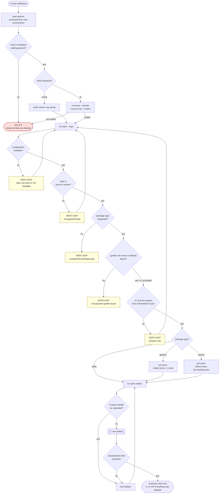
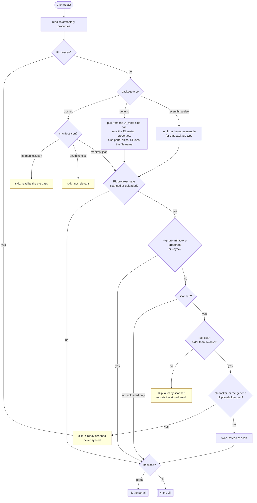
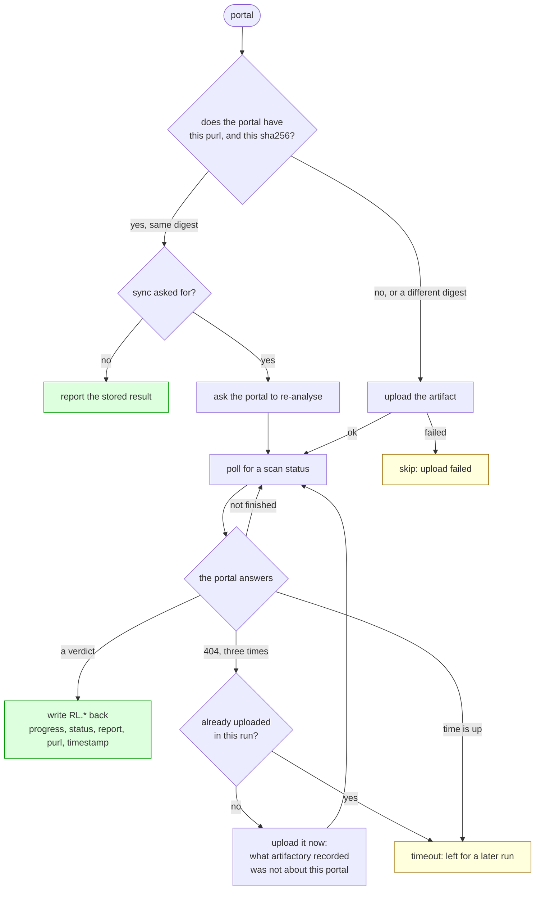
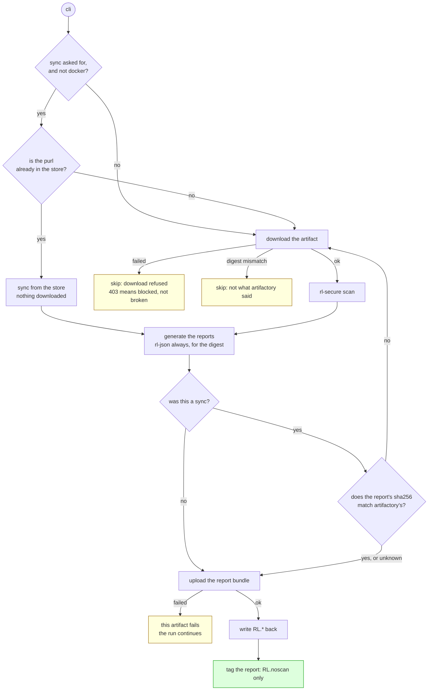

# rl-scan-artifactory — the flow

Four diagrams, outermost first. One diagram for all 72 decision points would be
unreadable, so each layer ends where the next begins and says which one.

Every branch here is pinned by a test; the file and test are named under each
diagram, so a diagram that stops matching the code is a diagram someone changed
without changing the tests.

---

## 1. A run: repositories

`my_app.py` — `run_all`, `_why_skip_this_repo`, `_process_repo_items`.
Tested in `test_run_one_repo.py`, `test_my_args.py`, `test_main_exit_codes.py`.

The four skip reasons differ in one way worth knowing: the two about the
repository are always printed, the two about how the run was invoked only with
`--verbose`, because a run over many repositories would otherwise repeat them.

---

## 2. One artifact: is it a candidate, and what does the purl look like

`process()` in each of the three processors.
Tested in `test_docker_process.py`, `test_generic_process.py`,
`test_default_process.py`, `test_file_properties.py`.

Docker cannot skip the download even when the answer is "already scanned": the
purl needs the architecture, the architecture is in the config blob, and the
config blob is only reachable by downloading the manifest and following it.

For generic in **cli** mode without a side-car or `RL.meta.*` properties the purl
is the placeholder `<repo>/<file name>@v0`. It names a file, not a package
version, so it is never synced - there and only there (R7.11.6).

---

## 3. The portal

`_process_portal` in each processor, `_wait_for_scan_status_one_portal` in the
common one. Tested in `test_portal_wait.py`, `test_spectra_assure_api.py`.

The digest comparison is skipped for **docker**, whose upload is a bundle this
integration assembles, so artifactory holds no hash of it to compare against.

The 404 path is the one to read twice. `RL.progress` does not record which
backend wrote it, so a `scanned` left by a cli run makes a portal run believe the
artifact is already there; the portal saying "no such version" three times is
what settles it.

---

## 4. The cli

`do_cli_scan_or_sync` and `do_cli_after_download` in the common processor.
Tested in `test_report_hashes.py`, `test_scan_cli_local.py`,
`test_scan_cli_docker.py`, `test_run_containment.py`.

The digest is checked **after** the sync, from the report the sync produced
anyway: a matching digest is the ordinary case and costs nothing, while checking
first would cost a report generation on every artifact.

`unknown` counts as a match on purpose — no report, an unreadable one, or no
`sha2` in artifactory all mean "cannot tell", and doing the full work again on a
guess is worse than trusting the sync.
